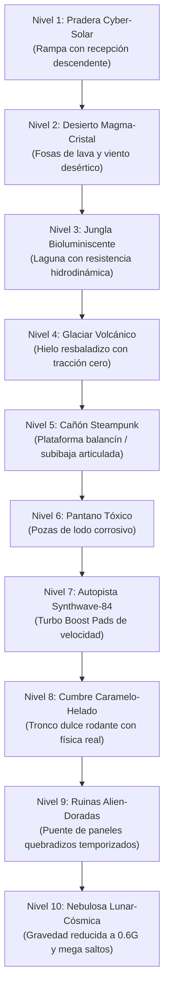

# 🏎️💨 ToroCorp: Rutas de Poder (Odisea Antigravedad)

> **Videojuego de carreras arcade 2D basado en físicas de suspensión elástica, tracción trasera (RWD), acrobacias aéreas y supervivencia por combustible crítico.**  
> Desarrollado por **ToroCorp Studio** en **Godot Engine 4.x** (GDScript 2.0).

---

## 📌 Tabla de Contenidos
- [Descripción y High Concept](#-descripción-y-high-concept)
- [Pilares de Diseño](#-pilares-de-diseño)
- [Características Principales](#-características-principales)
- [Catálogo de 11 Vehículos](#-catálogo-de-11-vehículos)
- [Los 10 Biomas y Mecánicas Exclusivas](#-los-10-biomas-y-mecánicas-exclusivas)
- [Esquema de Controles](#-esquema-de-controles)
- [Arquitectura Técnica del Proyecto](#-arquitectura-técnica-del-proyecto)
- [Descargas e Instalación](#-descargas-e-instalación)
- [Documentación Detallada](#-documentación-detallada)
- [Créditos y Equipo](#-créditos-y-equipo)

---

## 🎯 Descripción y High Concept

En el universo corporativo futurista de **ToroCorp Industries**, los pilotos de pruebas son enviados a los confines del planeta para conquistar rutas extremas a bordo de prototipos terrestres modificados. El jugador debe conducir a lo largo de terrenos generados proceduralmente, gestionando la tensión constante entre acelerar a fondo para librar precipicios y conservar el combustible justo para alcanzar el siguiente bidón antes de que el motor se apague o el vehículo vuelque.

### High Concept
> *"Hill Climb Racing potenciado con físicas de suspensión elástica bicapa, acrobacias aéreas con torque reactivo, economía de taller permanente y 10 biomas con obstáculos dinámicos diseñados para poner a prueba los reflejos del piloto."*

---

## ⚡ Pilares de Diseño

1. **Física Expresiva de Dos Pedales (Fácil de aprender, difícil de dominar):**  
   Cada aceleración transfiere masa dinámicamente hacia el eje trasero (provocando caballitos o burnout), y cada frenada hunde la trompa. En el aire, los mismos dos pedales controlan el giro angular (*pitch*) para realizar aterrizajes perfectos, *Frontflips* y *Backflips*.
2. **Tensión Constante entre Velocidad y Supervivencia:**  
   Ir rápido permite superar colinas empinadas y saltar fosas de magma o lagunas, pero incrementa el riesgo de volcar y sufrir una derrota instantánea al golpear la cabeza del piloto contra el suelo.
3. **Progresión Tangible en el Taller:**  
   Cada metro recorrido y cada moneda o rubí recolectado se conservan tras cada intento, alimentando mejoras permanentes en 4 áreas esenciales: **Motor Toro-V8**, **Amortiguación Hidráulica**, **Neumáticos Oruga** y **Tanque de Combustible**.

---

## ✨ Características Principales

- **Simulación Física RigidBody2D:** Chasis dinámico con detección de colisiones mediante `ShapeCast2D` y `RayCast2D`, eliminando enganches y asegurando 60 FPS estables.
- **Generador Procedural Infinito:** Algoritmo de curvas sinusoidales continuas con sistema de *Object Pooling* (`_chunk_pool`) para reciclaje óptimo de memoria en tiempo real.
- **Audio Procedural en Memoria:** 8 efectos de audio WAV sintetizados y modulados en tiempo real (revoluciones del motor según velocidad, chirrido de neumáticos, derrape, colisiones y campanas de gemas).
- **Economía Dual:** Monedas doradas para mejoras de piezas mecánicas y **Rubíes Rojos** exclusivos para comprar vehículos especiales como la *Banana con Ruedas*.
- **Multiplataforma:** Soporte nativo y optimizado para **PC (Windows)** con instalador guiado y dispositivos móviles **Android (APK)**.

---

## 🚗 Catálogo de 11 Vehículos

Todos los vehículos cuentan con masa, torque, suspensión y centro de gravedad parametrizados individualmente en `GameManager`:

| Vehículo | Categoría | Desbloqueo | Características Principales |
| :--- | :---: | :---: | :--- |
| **Toro 4x4** | Todoterreno | Inicial ($0) | Equilibrado, tracción constante y excelente estabilidad en baches. |
| **Scooter Urbana** | Ligero | Monedas | Ágil, bajo consumo de gasolina y gran aceleración inicial. |
| **Moto Cross X** | Acrobático | Monedas | Rotación aérea ultrarrápida, ideal para encadenar *Backflips*. |
| **Tractor Agrícola** | Pesado | Monedas | Gran torque en pendientes empinadas; ruedas traseras colosales. |
| **Auto de Policía** | Velocidad | Monedas | Gran velocidad punta y sirena visual de persecución. |
| **Camión de Basura** | Pesado | Monedas | Centro de masa retrasado; derriba obstáculos con facilidad. |
| **Autobús Escolar** | Largo | Monedas | Chasis extendido que requiere precisión en las crestas de colinas. |
| **Camión de Bomberos** | Resistencia | Monedas | Chasis reforzado con amortiguación de alto impacto. |
| **Carro de Velocidad** | Deportivo | Monedas | Aerodinámica agresiva y máxima velocidad en rectas llanas. |
| **Camión Monstruo** | Extremo | Monedas | Neumáticos gigantes que absorben cualquier impacto vertical. |
| **Banana con Ruedas** | Especial | **Rubíes** | Vehículo humorístico de alta velocidad y física ultraligera. |

---

## 🗺️ Los 10 Biomas y Mecánicas Exclusivas

Cada nivel cuenta con su propia paleta visual, densidad de relieve y un **obstáculo característico único**:



---

## 🎮 Esquema de Controles

### En PC (Teclado)
- **Acelerar / Inclinar hacia atrás en aire:** `W` / `Flecha Arriba` / `Barra Espaciadora`
- **Frenar / Reversa / Inclinar hacia adelante en aire:** `S` / `Flecha Abajo`
- **Equilibrar trompa abajo:** `A` / `Flecha Izquierda`
- **Equilibrar cola abajo:** `D` / `Flecha Derecha`
- **Pausar Partida:** `Escape` / `P`

### En Android / Táctil
- **Pedal Derecho (Verde):** Acelerador / Torque aéreo positivo.
- **Pedal Izquierdo (Rojo):** Freno / Reversa / Torque aéreo negativo.

---

## 🏗️ Arquitectura Técnica del Proyecto

El proyecto está diseñado bajo una arquitectura modular limpia en Godot 4:

```
VideojuegoEquipo/
├── assets/                  # Sprites, texturas, audios WAV y fuentes
│   ├── audio/              # Efectos de sonido procedurales y música
│   ├── backgrounds/        # Fondos Parallax bicapa por bioma
│   ├── sprites/            # Texturas de vehículos, ruedas y obstáculos
│   └── textures/           # Tiles de suelo y subsuelo
├── builds/                  # Paquetes compilados y ejecutables
│   ├── android/            # APK firmado para Android
│   └── windows/            # Instalador Setup.exe, ZIP portable y ejecutable
├── docs/                    # Documentación técnica, manuales y GDD
├── scenes/                  # Escenas organizadas del motor
│   ├── collectibles/       # Monedas, bidones de gasolina y rubíes
│   ├── terrain/            # TerrainGenerator y TerrainChunk con Pooling
│   ├── ui/                 # Menús, Garaje/Taller, HUD y Game Over
│   ├── vehicle/            # Chasis RigidBody2D, suspensión y ruedas
│   └── game.tscn           # Escena principal de carrera
├── scripts/
│   └── autoload/           # Singletons globales (GameManager y SoundManager)
├── export_presets.cfg       # Configuraciones de exportación para Windows y Android
└── project.godot            # Configuración general del motor Godot 4.x
```

---

## 📦 Descargas e Instalación

Los instaladores oficiales se encuentran listos para ejecución en la carpeta `builds/`:

| Versión | Archivo | Plataforma | Instalación |
| :--- | :--- | :---: | :--- |
| **Instalador Oficial** | `Setup_ToroCorp_Rutas_de_Poder.exe` | Windows 10/11 | Asistente paso a paso con accesos directos y desinstalador. |
| **Paquete Portable** | `ToroCorp_Rutas_de_Poder_PC_Windows.zip` | Windows PC | Descomprimir y ejecutar directamente `ToroCorp_Rutas_de_Poder.exe`. |
| **Android APK** | `ToroCorp_Rutas_de_Poder.apk` | Android 8.0+ | Instalar directamente en el móvil habilitando orígenes desconocidos. |

---

## 📚 Documentación Detallada

Para consultar la información a profundidad, visita los manuales de la carpeta [`docs/`](docs/):
- 📄 **[GDD Completo del Videojuego](docs/GDD_COMPLETO.md):** Documento formal de diseño de juego, narrativa, metas y economía.
- 🛠️ **[Arquitectura Técnica](docs/ARQUITECTURA_TECNICA.md):** Estructura del código, singletons, físicas y generador de chunks.
- 📖 **[Manual del Jugador](docs/MANUAL_DE_JUEGO.md):** Guía de vehículos, costos del taller, acrobacias y consejos de conducción.
- 🧪 **[Reporte de Playtesting](docs/PLAYTESTING_Y_RESULTADOS.md):** Resultados de pruebas con usuarios (Leonardo Murataya, Juan Melquiades, Diego Cardenas, Angel Acosta).
- ⚙️ **[Guía de Instalación y Compilación](docs/GUIA_INSTALACION.md):** Paso a paso para compilar desde Godot 4 o usar los instaladores.
- 📅 **[Historial de Sprints](docs/HISTORIAL_SPRINTS.md):** Bitácora de las 8 semanas de desarrollo del equipo.

---

## 👥 Créditos y Equipo

**ToroCorp Studio**  
- **Julio Del Toro:** Dirección Técnica, Programación de Físicas 2D, Generación Procedural de Terreno y Arquitectura del Sistema.
- **Juan Melquiades:** Dirección Artística, Diseño de UI/UX, Audio Procedural, Balanceo Económico y Coordinación de Pruebas.

*Desarrollado como proyecto formal de desarrollo de videojuegos en Godot Engine 4. Noviembre 2026.*
