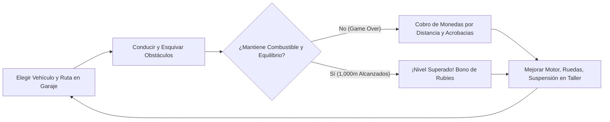

# 📄 Documento de Diseño de Juego (GDD) — ToroCorp: Rutas de Poder

**Estudio:** ToroCorp Studio  
**Integrantes:** Julio Del Toro & Juan Melquiades  
**Versión del Documento:** v1.0 (Producción Final)  
**Motor:** Godot Engine 4.x (GDScript)  

---

## 1. Visión General del Proyecto

### 1.1 Ficha de Identificación
- **Título Oficial:** *ToroCorp: Rutas de Poder (Odisea Antigravedad)*
- **Género:** Conducción Arcade 2D basada en Físicas (*Side-Scrolling Hill-Climbing Stunt Racing*)
- **Plataformas:** PC Windows (Teclado/Mouse) y Dispositivos Móviles Android (Táctil)
- **Público Objetivo:** Jugadores casuales y mid-core (10 a 35 años), clasificación ESRB E (Everyone / Para Todo Público).

### 1.2 Premisa Narrativa y Mundo del Juego
En el futuro corporativo dominado por el conglomerado industrial **ToroCorp**, la alta dirección convoca al "Torneo Rutas de Poder". En este certamen, los pilotos e ingenieros deben someter prototipos de vehículos terrestres a las condiciones climáticas más extremas de la galaxia: desde desiertos de magma incandescente hasta lunas con gravedad debilitada. Aquellos pilotos que logren recorrer 1,000 metros en cada bioma sin agotar su combustible ni volcar su máquina recibirán la distinción de Comandantes de Flota ToroCorp.

---

## 2. Pilares de Diseño y Core Loop

### 2.1 Pilares Fundamentales
1. **Física Expresiva de Dos Pedales:** Un sistema simple de acelerador y freno que en el suelo gobierna la tracción RWD y en el aire transfiere torque angular para estabilizar la nave o ejecutar saltos acrobáticos.
2. **Tensión Constante por Combustible:** El jugador debe evaluar permanentemente si acelerar al máximo para no quedarse sin tiempo o conservar inercia para evitar quedarse sin gasolina entre bidones distantes.
3. **Progresión Tangible en el Garaje:** Todo progreso en monedas y rubíes se almacena de forma persistente, permitiendo adquirir mejoras mecánicas que alteran perceptiblemente la potencia, agarre y peso del auto.

### 2.2 Core Loop (Ciclo de Juego)

---

## 3. Mecánicas de Juego Detalladas

### 3.1 Dinámica del Vehículo (Two-Pedal Physics)
- **Tracción Trasera (RWD):** El torque se aplica en el eje posterior. Acelerar súbitamente levanta el morro (caballito); si no se regula, puede provocar una volcadura hacia atrás.
- **Inclinación Aérea:**
  - Presionar **Acelerar / D** en el aire aplica torque horario (baja la cola / sube el morro).
  - Presionar **Frenar / A** en el aire aplica torque antihorario (baja la trompa).
- **Acrobacias (Flips):** Completar una rotación de 360° en el aire sin tocar el suelo premia con monedas adicionales (+50 monedas por Frontflip o Backflip).
- **Detección de Derrota:**
  - *Driver Head Hit:* Si el colisionador de la cabeza del piloto colisiona con el suelo a más de 1.5 m/s, se produce un Game Over instantáneo por impacto.
  - *Out of Fuel:* Si el combustible llega a 0% y la velocidad desciende de 0.2 m/s, se declara derrota por agotamiento de combustible.

### 3.2 Obstáculos Singulares por Bioma
1. **Pradera Cyber-Solar (Nivel 1):** Mega rampas con pendientes receptoras calculadas para enseñar el aterrizaje suave.
2. **Desierto Magma-Cristal (Nivel 2):** Fosas de lava caliente que destruyen el vehículo si se cae en ellas, combinadas con ráfagas de viento.
3. **Jungla Bioluminiscente (Nivel 3):** Pozas de agua viscosa con resistencia hidrodinámica (desaceleración proporcional al cuadrado de la velocidad).
4. **Glaciar Volcánico (Nivel 4):** Zonas de hielo donde la fricción de los neumáticos cae a cero, obligando a confiar en el impulso.
5. **Cañón Steampunk (Nivel 5):** Plataformas balancín basculantes sobre pivotes; cruzar muy rápido inclina la rampa hacia el abismo.
6. **Pantano Tóxico (Nivel 6):** Ciénagas de ácido corrosivo que consumen combustible aceleradamente si el auto se sumerge.
7. **Autopista Synthwave-84 (Nivel 7):** Pistas de impulso *Turbo Boost Pads* de neón que duplican la velocidad lineal instantáneamente.
8. **Cumbre Caramelo (Nivel 8):** Troncos dulces rodantes que caen pendiente abajo y deben ser esquivados o empujados.
9. **Ruinas Alien-Doradas (Nivel 9):** Puentes flotantes con paneles que se quiebran 1 segundo después de que las ruedas los pisan.
10. **Nebulosa Lunar (Nivel 10):** Gravedad reducida a 0.6G; saltos astronómicos de gran altura con vuelos prolongados.

---

## 4. Economía del Juego y Progresión

### 4.1 Sistema de Monedas y Rubíes
- **Monedas Doradas:** Generadas proceduralmente en el camino y premiadas por distancia recorrida. Se utilizan para adquirir mejoras en el taller.
- **Rubíes Rojos:** Coleccionables de alta rareza ubicados en puntos de riesgo acrobático (cima de rampas o sobre fosas). Se usan para desbloquear vehículos prémium.

### 4.2 Tabla de Mejoras en Taller (Niveles 1 a 5)
| Componente | Nivel 1 (Base) | Nivel 2 | Nivel 3 | Nivel 4 | Nivel 5 (Máximo) |
| :--- | :---: | :---: | :---: | :---: | :---: |
| **Motor Toro-V8** | $0 (100% Torque) | $80 (+25%) | $200 (+50%) | $500 (+80%) | $1,200 (+120%) |
| **Suspensión Hidráulica** | $0 (100% Rigidez) | $60 (+20%) | $160 (+45%) | $400 (+70%) | $1,000 (+100%) |
| **Neumáticos Oruga** | $0 (1.0 Fricción) | $70 (1.3 Fricción)| $180 (1.6 Fricción)| $450 (2.0 Fricción)| $1,100 (2.5 Fricción)|
| **Tanque de Gasolina** | $0 (100 L) | $100 (125 L) | $250 (155 L) | $600 (190 L) | $1,500 (240 L) |
